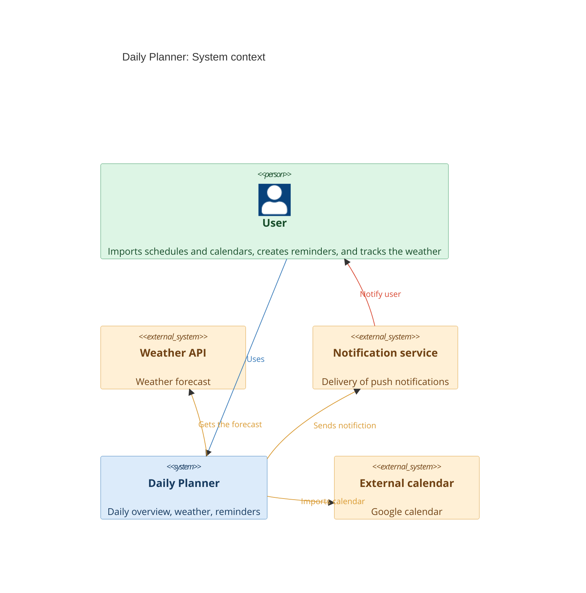

# C4 Context

The diagram shows who uses the Daily Planner and which external systems it connects to.

## Legend 

| Colour | Meaning |
|--------|---------|
| 🟩 Green | Person (system user) |
| 🟦 Blue | The system we are developing (Daily Planner) |
| 🟧 Orange | External system |

| Edge | Meaning |
|------|---------|
| 🔵 Blue arrow | User interaction with the Daily Planner |
| 🟠 Orange arrow | Daily Planner Communication with an External System|
| 🔴 Red arrow | Communication between the notification service and the user |
